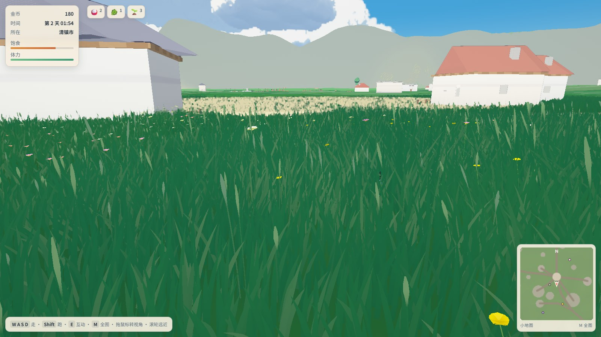
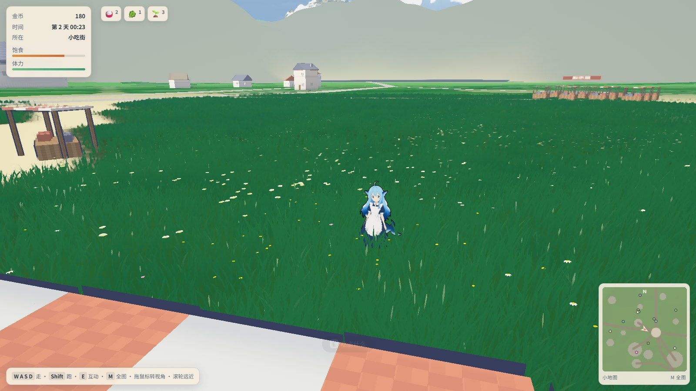
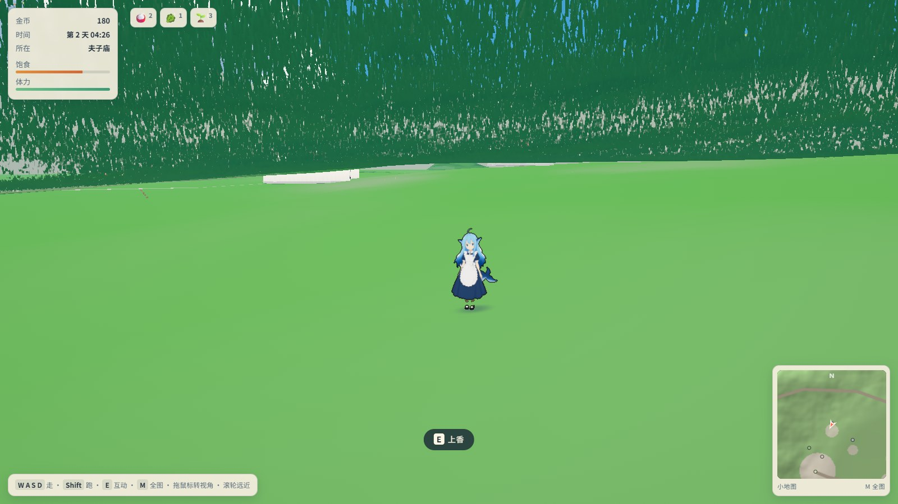
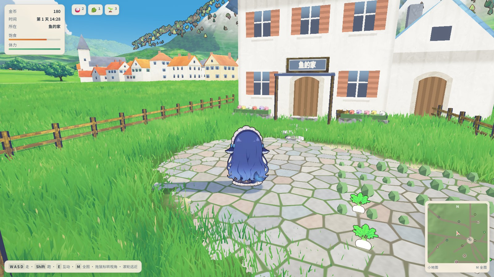
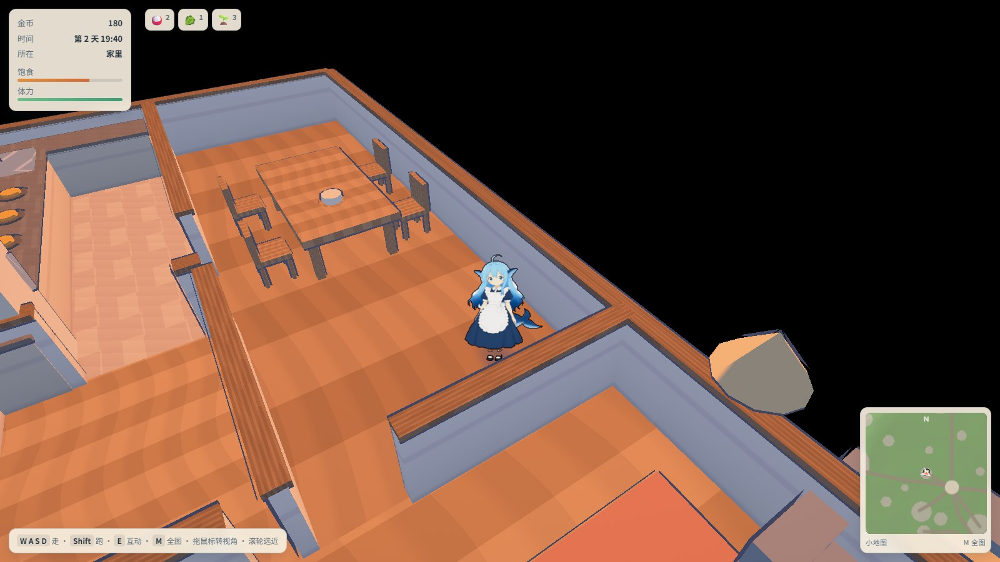
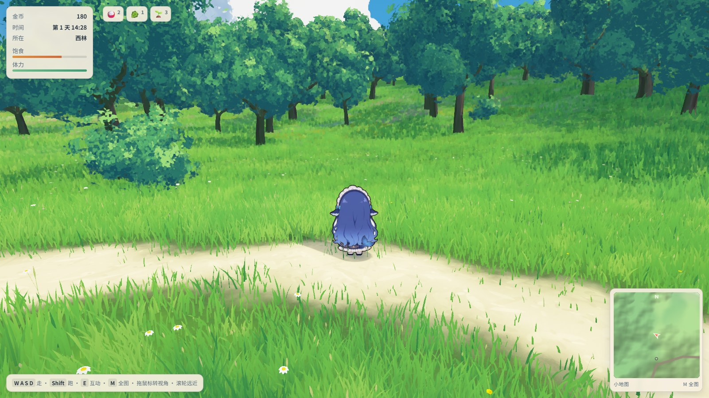
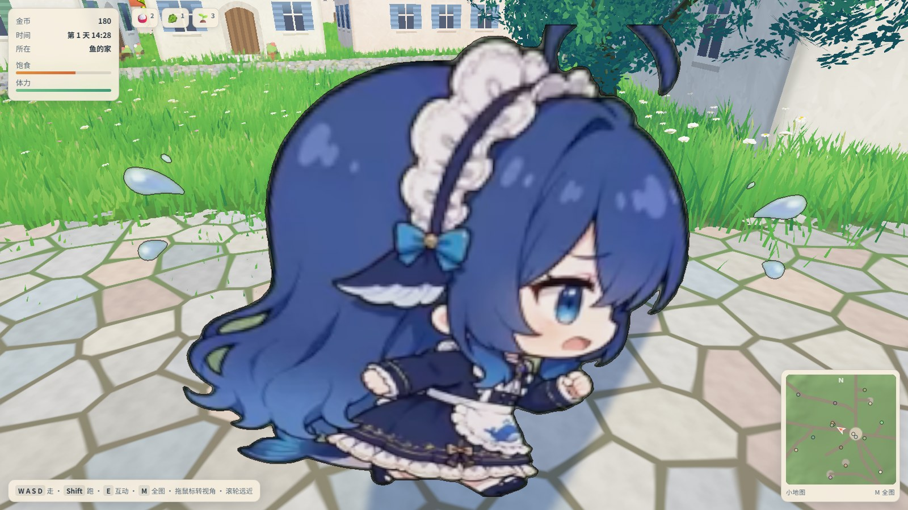

# DeepSeek's World · 小鲸鱼的世界

一个能走进去的吉卜力风小镇。画法沿用 [painted-valley](https://git.patch.gg/blendi/painted-valley)（MIT）那套「颜色按颜料调、细节靠墨线、收尾走一遍笔触」的做法，把它从一条山谷长成一座城。


*A walkable hand-painted town in three.js — WebGL2, no texture packs for the world itself, everything painted in shaders. Built on the [painted-valley](https://git.patch.gg/blendi/painted-valley) renderer.*

---

## 目录

- [这是什么](#这是什么)
- [截图](#截图)
- [怎么跑](#怎么跑)
- [操作](#操作)
- [地图上有什么](#地图上有什么)
- [能做些什么](#能做些什么)
- [技术说明](#技术说明)
- [素材与授权](#素材与授权)
- [已知限制](#已知限制)

---

## 这是什么

repository 里有两个 demo，共用同一套渲染骨架：

| 页面 | 是什么 |
|---|---|
| **`town.html`** | 小鲸鱼的世界：2 km × 2 km 的城镇、田野、森林、湖、雪山，可进屋、可互动 |
| `index.html` | 原来的山谷 demo（painted-valley 原样保留，说明见 [README-painted-valley.md](README-painted-valley.md)） |

主角是社区二创的 **DeepSeek 鲸鱼娘**形象（取自桌面宠物插件 `dsh-pet` 的官方立绘），三向立牌：镜头转到正面、侧面、背面各用一张图。

---

## 截图

| | |
|---|---|
|  **中央广场**：喷泉、长椅、路灯，26 只鸽子会被你惊飞 |  **清镇市城门**：牌坊和两翼城墙 |
|  **小吃街**：9 个摊位，横幅上写着烤鱼和白米饭 |  **教堂**：中殿、钟塔和玫瑰窗 |
|  **夫子庙**：重檐青瓦、朱红柱、匾额 |  **小鲸鱼的家**：门口就是菜地 |
|  **四室两厅**：16 × 12 m，层高 2.9 m，家具按真实尺寸 |  **野花**：139 种手绘立牌，会随风摆、跟着一天的光变 |
|  **城外的森林**：110 种树 |  **走在街上**：第三人称，默认看到她的背影 |

---

## 怎么跑

需要 **Node.js 20+**。

```bash
npm install          # 只装 three + vite + playwright-core
npm run build        # 产出 dist/
npm run serve        # 起在 http://127.0.0.1:5383/
```

然后打开：

- **http://127.0.0.1:5383/town.html** —— 小鲸鱼的世界
- http://127.0.0.1:5383/index.html —— 原来的山谷

> 必须用服务器打开，不能双击 HTML —— 页面用的是 ES module，还要 fetch 贴图。

### 画质参数

| 参数 | 作用 |
|---|---|
| `?quality=high` | 默认。MSAA 4×、云图 2048、远山贴条 12288、地面 1.5 m/纹素 |
| `?quality=medium` | 推荐给核显：MSAA 2×、云图 1024、远山 4096 |
| `?quality=low` 或 `?lite=1` | 最低档：无 MSAA、云图 512、草更稀 |
| `?dpr=0.8` | 少画像素再拉伸（最省的一档） |
| `?tex=0` | 关掉建筑/室内/街道设施的 43 张手绘贴图变体，回到纯 shader 版 |
| `?texmix=0.5` | 贴图强度（0~1，默认 0.85） |
| `?roadtex=0` | 路面退回程序化的卵石画法（默认用手绘贴图版） |
| `?plants=0` | 野花退回程序化低模（对比用） |
| `?paint=0` | 关掉 Kuwahara 笔触收尾 |

例：**`town.html?quality=medium&dpr=0.85`** 是核显上比较舒服的组合。

---

## 操作

| 键 | 作用 |
|---|---|
| `W A S D` / 方向键 | 走（方向跟着镜头） |
| `Shift` | 跑 |
| **`E`** | 互动（屏幕下方会提示能做什么）；在屋里是用家具；坐着时是起身 |
| `M` | 小地图切换「以人为中心的雷达」/「全图」 |
| 拖鼠标 / 点一下画面锁鼠标 | 转视角 |
| 滚轮 | 拉近拉远 |
| `Esc` | 关面板 / 解锁鼠标 |
| `F` | 开关笔触收尾 |

---

## 地图上有什么

世界坐标 2 km 见方。从家门口往东南 120 m 是中央广场，四条街由广场放射出去；城区半径 430 m，外面是田野、森林、湖和山。

**城市**：小鲸鱼的家 · 中央广场 · 小吃街 · 网吧 · 超市 · 菜市场 · 花鸟市场 · 图书馆 · 学校（清镇市第一小学 / 中学 / 大学）· 教堂 · 夫子庙 · 电玩厅 · 体育馆 · 冒险者协会 · 三个居民区 · 清镇市牌坊城门

**城外**：农村 · 田亩（梯田）· 西林 / 东林 · 湖（水面、湖底、水草）· 环山与雪山

**室内**（16 × 12 m，四室两厅）：客厅 7.5×7.0 · 厨房 4.5×3.0 · 餐厅 4.5×4.0 · 卫生间 4×3 · 玄关 4×4 · 主卧 4.5×5 · 次卧 3.5×5 · 小卧室 3×5 · 客房 2.5×5 · 书房 2.5×5

---

## 能做些什么

- **钓鱼**：抛竿 → 等「上钩了」→ 1.5 秒内按 E 拉竿，小概率钓到珍珠
- **种植**：门前菜地按 E 种菜，过一会儿回来收割
- **烹饪**：厨房 4 个菜谱（饭团 / 烤鱼饭 / 青菜粥 / 清炒时蔬）
- **买菜 / 逛超市 / 小吃街**：金币交易
- **上网**：论坛发帖赚补贴 · **打电玩**：滑轨停指针，5 轮换钱
- **接委托**：钓 3 条鱼换 60 金币，有进度追踪
- **看电视**：屏幕上真的在放片子（Canvas 实时画的）；**沙发能坐**，坐下镜头落到座位高度
- **看图鉴 / 睡觉 / 洗澡 / 看书 / 祈祷 / 采花 / 翻信箱**
- **天气与时间**：白天到黄昏到夜晚，路灯会亮

---

## 技术说明

### 沿用的（来自 painted-valley，基本没改）

- **`src/lib/frame.js` 的收尾**：HDR → 火 → 合成 → bloom → **Kuwahara 笔触 + alpha 墨线** → 画家曲线。整个项目的「吉卜力感」主要来自这一步。
- **`src/lib/` 的草地系统**：instanced 草叶、踩踏记忆、野花、割草、火焰。
- **`src/valley/sky.js` + `clouds.js` + `backdrop.js`**：云一次烘进 cubemap、远山烘成贴条、4 组时刻色插值。

### 新写的（`src/town/`，约 4 千行）

| 文件 | 职责 |
|---|---|
| `plan.js` | 地形纯函数 `heightAt(x,z)` + 31 个街区的数据表 + 路网 + 湖 + 铺装判定 |
| `paint.js` | cel 材质：两阶色 + 倒壳描边 + shader 里长的瓦行/墙渍/木纹/砌石；43 张 albedo 贴图变体（墙 8 / 瓦 6 / 木 6 / 石 4 / 桥 4 / 路 4 / 灯 3 / 街具 5 / 布·雪·田），按建筑的调色板序号分配，世界坐标三平面采样 |
| `buildings.js` | 建筑生成器（民居/厅堂/教堂/庙/牌坊/喷泉/体育馆/摊位/路灯/长椅…），按材质合并 |
| `props.js` | 远地面、湖、树、田垄、石头、野花、鸽子、小动物、路面、广场 |
| `city.js` | 把街区摆好，产出「场景 + 碰撞盒 + 互动点」 |
| `player.js` | 鲸鱼娘三向立牌 + 第三人称相机 + 走路碰撞 |
| `interior.js` | 四室两厅，真实尺寸，墙有剖面避免挡镜头 |
| `billboard.js` | 植物立牌批渲染（风摆 + 实时染色 + alpha 墨线技巧） |
| `ui.js` / `interactions.js` | HUD、面板、小地图、以及那一堆互动 |

### 三个值得说的做法

1. **主角的 alpha 技巧**：立牌材质是 `alphaTest` 的**不透明**材质，片元里写 `alpha = 0.16`。于是 `frame.js` 的笔触收尾判定「这已经是一幅画」→ 不给她上 Kuwahara（手绘线条保住）；而墨线检测看到她与背景 alpha 差 0.84 → **自动描一圈墨线**。一行新代码没加，全用原作现成机制。
2. **贴图只借亮度，不借光**：albedo 用世界坐标三平面采样（不依赖 UV），只取相对平均色的偏差，再按实测标准差自动补对比度。所以奶油墙还是奶油墙，只是多了笔触和水渍，不会双重打光。
3. **立牌打包**：257 个植物/物件精灵打成 4 张图集（花 139 个 / 树 110 个 / 物件 8 个），约 4000 朵野花只花 **2 个 draw call**。

---

## 素材与授权

> **全部贴图与精灵的清单、地址和逐项介绍见 [docs/贴图说明.md](docs/贴图说明.md)**（43 张可平铺材质 + 30 张城镇设施贴图 + 621 个精灵 + 4 张植物图集，含每个文件的相对路径）。

- **代码**：MIT（沿用 painted-valley 的协议，见 [LICENSE](LICENSE)）
- **山谷原作的画**：CC0，作者 Patch，见 [LICENCE-NOTES.md](LICENCE-NOTES.md)
- **鲸鱼娘形象**：来自 DSH 桌面宠物插件 `dsh-pet` 的官方立绘（社区二创形象，原型为 B 站 UP 主「上善无形」的原创角色「溟月」）
- **本仓库新增的手绘贴图与植物精灵**：由 AI 生成（dashscope qwen-image），经本地脚本处理成 albedo / 图集
- 用到的第三方库：three.js（MIT）、Rapier（Apache-2.0）、vite（MIT）

> 城镇的**地形、建筑、天空、草地、路面**没有用任何贴图文件 —— 全部在 shader 里算。贴图只用于室内表面、地标建筑和植物立牌。

---

## 已知限制

- **只有自己家能进**；其他建筑是门面 + 交互，没有内景。
- **不能潜水**：湖有水面、湖底和水草，但岸边会挡住。
- **树还是低模**：110 种树的图集已经做好（`public/textures/plants/trees.png`），但城市里暂时用 3D 低模，还没换成 billboard。
- **没有存档**，刷新回到第一天早上。
- 性能参考：Intel UHD 630 核显上 `?quality=medium` 约 15–20 fps，`?lite=1` 约 19 fps；独显满帧。场景在 medium 下约 450 draw call / 9 M 三角。
- 贴图与图集走 **Git LFS**，克隆前请确认装了 `git-lfs`。

---

## 接下来想做的

- [ ] 树换成「近处 3D + 远处 billboard」的 LOD
- [ ] 鱼群、蜻蜓、河虾做成湖边的活物
- [ ] 采集图鉴（用 `critters.png` 那 8 个图标）
- [ ] 存档
- [ ] 更多街区：网吧内景、菜市场内景

---

<sub>Built on [painted-valley](https://git.patch.gg/blendi/painted-valley) by Patch · MIT code / CC0 art</sub>