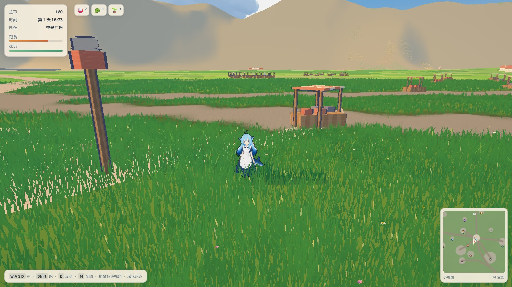
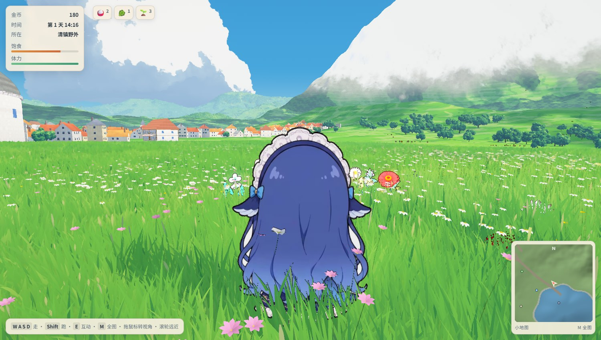

# DeepSeek's World 路 灏忛哺楸肩殑涓栫晫

涓€涓兘璧拌繘鍘荤殑鍚夊崪鍔涢灏忛晣銆傜敾娉曟部鐢?[painted-valley](https://git.patch.gg/blendi/painted-valley)锛圡IT锛夐偅濂椼€岄鑹叉寜棰滄枡璋冦€佺粏鑺傞潬澧ㄧ嚎銆佹敹灏捐蛋涓€閬嶇瑪瑙︺€嶇殑鍋氭硶锛屾妸瀹冧粠涓€鏉″北璋烽暱鎴愪竴搴у煄銆?
 renderer.*

---

## 鐩綍

- [杩欐槸浠€涔圿(#杩欐槸浠€涔?
- [鎴浘](#鎴浘)
- [鎬庝箞璺慮(#鎬庝箞璺?
- [鎿嶄綔](#鎿嶄綔)
- [鍦板浘涓婃湁浠€涔圿(#鍦板浘涓婃湁浠€涔?
- [鑳藉仛浜涗粈涔圿(#鑳藉仛浜涗粈涔?
- [鎶€鏈鏄嶿(#鎶€鏈鏄?
- [绱犳潗涓庢巿鏉僝(#绱犳潗涓庢巿鏉?
- [宸茬煡闄愬埗](#宸茬煡闄愬埗)

---

## 杩欐槸浠€涔?
repository 閲屾湁涓や釜 demo锛屽叡鐢ㄥ悓涓€濂楁覆鏌撻鏋讹細

| 椤甸潰 | 鏄粈涔?|
|---|---|
| **`town.html`** | 灏忛哺楸肩殑涓栫晫锛? km 脳 2 km 鐨勫煄闀囥€佺敯閲庛€佹．鏋椼€佹箹銆侀洩灞憋紝鍙繘灞嬨€佸彲浜掑姩 |
| `index.html` | 鍘熸潵鐨勫北璋?demo锛坧ainted-valley 鍘熸牱淇濈暀锛岃鏄庤 [README-painted-valley.md](README-painted-valley.md)锛?|

涓昏鏄ぞ鍖轰簩鍒涚殑 **DeepSeek 椴搁奔濞?*褰㈣薄锛堝彇鑷闈㈠疇鐗╂彃浠?`dsh-pet` 鐨勫畼鏂圭珛缁橈級锛屼笁鍚戠珛鐗岋細闀滃ご杞埌姝ｉ潰銆佷晶闈€佽儗闈㈠悇鐢ㄤ竴寮犲浘銆?
---

## 鎴浘

| | |
|---|---|
|  **涓ぎ骞垮満**锛氬柗娉夈€侀暱妞呫€佽矾鐏紝26 鍙附瀛愪細琚綘鎯婇 |  **鍥涘涓ゅ巺**锛?6 脳 12 m锛屽眰楂?2.9 m锛屽鍏锋寜鐪熷疄灏哄 |  **閲庤姳**锛?39 绉嶆墜缁樼珛鐗岋紝浼氶殢椋庢憜銆佽窡鐫€涓€澶╃殑鍏夊彉 |
|  **璧板湪琛椾笂**锛氱涓変汉绉帮紝榛樿鐪嬪埌濂圭殑鑳屽奖 |

---

## 鎬庝箞璺?
闇€瑕?**Node.js 20+**銆?
```bash
npm install          # 鍙 three + vite + playwright-core
npm run build        # 浜у嚭 dist/
npm run serve        # 璧峰湪 http://127.0.0.1:5383/
```

鐒跺悗鎵撳紑锛?
- **http://127.0.0.1:5383/town.html** 鈥斺€?灏忛哺楸肩殑涓栫晫
- http://127.0.0.1:5383/index.html 鈥斺€?鍘熸潵鐨勫北璋?
> 蹇呴』鐢ㄦ湇鍔″櫒鎵撳紑锛屼笉鑳藉弻鍑?HTML 鈥斺€?椤甸潰鐢ㄧ殑鏄?ES module锛岃繕瑕?fetch 璐村浘銆?
### 鐢昏川鍙傛暟

| 鍙傛暟 | 浣滅敤 |
|---|---|
| `?quality=high` | 榛樿銆侻SAA 4脳銆佷簯鍥?2048銆佽繙灞辫创鏉?12288銆佸湴闈?1.5 m/绾圭礌 |
| `?quality=medium` | 鎺ㄨ崘缁欐牳鏄撅細MSAA 2脳銆佷簯鍥?1024銆佽繙灞?4096 |
| `?quality=low` 鎴?`?lite=1` | 鏈€浣庢。锛氭棤 MSAA銆佷簯鍥?512銆佽崏鏇寸█ |
| `?dpr=0.8` | 灏戠敾鍍忕礌鍐嶆媺浼革紙鏈€鐪佺殑涓€妗ｏ級 |
| `?tex=0` | 鍏虫帀寤虹瓚/瀹ゅ唴鐨勬墜缁樿创鍥撅紝鍥炲埌绾?shader 鐗?|
| `?texmix=0.5` | 璐村浘寮哄害锛?~1锛岄粯璁?0.85锛?|
| `?plants=0` | 閲庤姳閫€鍥炵▼搴忓寲浣庢ā锛堝姣旂敤锛?|
| `?paint=0` | 鍏虫帀 Kuwahara 绗旇Е鏀跺熬 |

渚嬶細**`town.html?quality=medium&dpr=0.85`** 鏄牳鏄句笂姣旇緝鑸掓湇鐨勭粍鍚堛€?
---

## 鎿嶄綔

| 閿?| 浣滅敤 |
|---|---|
| `W A S D` / 鏂瑰悜閿?| 璧帮紙鏂瑰悜璺熺潃闀滃ご锛?|
| `Shift` | 璺?|
| **`E`** | 浜掑姩锛堝睆骞曚笅鏂逛細鎻愮ず鑳藉仛浠€涔堬級锛涘湪灞嬮噷鏄敤瀹跺叿锛涘潗鐫€鏃舵槸璧疯韩 |
| `M` | 灏忓湴鍥惧垏鎹€屼互浜轰负涓績鐨勯浄杈俱€?銆屽叏鍥俱€?|
| 鎷栭紶鏍?/ 鐐逛竴涓嬬敾闈㈤攣榧犳爣 | 杞瑙?|
| 婊氳疆 | 鎷夎繎鎷夎繙 |
| `Esc` | 鍏抽潰鏉?/ 瑙ｉ攣榧犳爣 |
| `F` | 寮€鍏崇瑪瑙︽敹灏?|

---

## 鍦板浘涓婃湁浠€涔?
涓栫晫鍧愭爣 2 km 瑙佹柟銆備粠瀹堕棬鍙ｅ線涓滃崡 120 m 鏄腑澶箍鍦猴紝鍥涙潯琛楃敱骞垮満鏀惧皠鍑哄幓锛涘煄鍖哄崐寰?430 m锛屽闈㈡槸鐢伴噹銆佹．鏋椼€佹箹鍜屽北銆?
**鍩庡競**锛氬皬椴搁奔鐨勫 路 涓ぎ骞垮満 路 灏忓悆琛?路 缃戝惂 路 瓒呭競 路 鑿滃競鍦?路 鑺遍笩甯傚満 路 鍥句功棣?路 瀛︽牎锛堟竻闀囧競绗竴灏忓 / 涓 / 澶у锛壜?鏁欏爞 路 澶瓙搴?路 鐢电帺鍘?路 浣撹偛棣?路 鍐掗櫓鑰呭崗浼?路 涓変釜灞呮皯鍖?路 娓呴晣甯傜墝鍧婂煄闂?
**鍩庡**锛氬啘鏉?路 鐢颁憨锛堟鐢帮級路 瑗挎灄 / 涓滄灄 路 婀栵紙姘撮潰銆佹箹搴曘€佹按鑽夛級路 鐜北涓庨洩灞?
**瀹ゅ唴**锛?6 脳 12 m锛屽洓瀹や袱鍘咃級锛氬鍘?7.5脳7.0 路 鍘ㄦ埧 4.5脳3.0 路 椁愬巺 4.5脳4.0 路 鍗敓闂?4脳3 路 鐜勫叧 4脳4 路 涓诲崸 4.5脳5 路 娆″崸 3.5脳5 路 灏忓崸瀹?3脳5 路 瀹㈡埧 2.5脳5 路 涔︽埧 2.5脳5

---

## 鑳藉仛浜涗粈涔?
- **閽撻奔**锛氭姏绔?鈫?绛夈€屼笂閽╀簡銆嶁啋 1.5 绉掑唴鎸?E 鎷夌锛屽皬姒傜巼閽撳埌鐝嶇彔
- **绉嶆**锛氶棬鍓嶈彍鍦版寜 E 绉嶈彍锛岃繃涓€浼氬効鍥炴潵鏀跺壊
- **鐑归オ**锛氬帹鎴?4 涓彍璋憋紙楗洟 / 鐑ら奔楗?/ 闈掕彍绮?/ 娓呯倰鏃惰敩锛?- **涔拌彍 / 閫涜秴甯?/ 灏忓悆琛?*锛氶噾甯佷氦鏄?- **涓婄綉**锛氳鍧涘彂甯栬禋琛ヨ创 路 **鎵撶數鐜?*锛氭粦杞ㄥ仠鎸囬拡锛? 杞崲閽?- **鎺ュ鎵?*锛氶挀 3 鏉￠奔鎹?60 閲戝竵锛屾湁杩涘害杩借釜
- **鐪嬬數瑙?*锛氬睆骞曚笂鐪熺殑鍦ㄦ斁鐗囧瓙锛圕anvas 瀹炴椂鐢荤殑锛夛紱**娌欏彂鑳藉潗**锛屽潗涓嬮暅澶磋惤鍒板骇浣嶉珮搴?- **鐪嬪浘閴?/ 鐫¤ / 娲楁尽 / 鐪嬩功 / 绁堢シ / 閲囪姳 / 缈讳俊绠?*
- **澶╂皵涓庢椂闂?*锛氱櫧澶╁埌榛勬槒鍒板鏅氾紝璺伅浼氫寒

---

## 鎶€鏈鏄?
### 娌跨敤鐨勶紙鏉ヨ嚜 painted-valley锛屽熀鏈病鏀癸級

- **`src/lib/frame.js` 鐨勬敹灏?*锛欻DR 鈫?鐏?鈫?鍚堟垚 鈫?bloom 鈫?**Kuwahara 绗旇Е + alpha 澧ㄧ嚎** 鈫?鐢诲鏇茬嚎銆傛暣涓」鐩殑銆屽悏鍗滃姏鎰熴€嶄富瑕佹潵鑷繖涓€姝ャ€?- **`src/lib/` 鐨勮崏鍦扮郴缁?*锛歩nstanced 鑽夊彾銆佽俯韪忚蹇嗐€侀噹鑺便€佸壊鑽夈€佺伀鐒般€?- **`src/valley/sky.js` + `clouds.js` + `backdrop.js`**锛氫簯涓€娆＄儤杩?cubemap銆佽繙灞辩儤鎴愯创鏉°€? 缁勬椂鍒昏壊鎻掑€笺€?
### 鏂板啓鐨勶紙`src/town/`锛岀害 4 鍗冭锛?
| 鏂囦欢 | 鑱岃矗 |
|---|---|
| `plan.js` | 鍦板舰绾嚱鏁?`heightAt(x,z)` + 31 涓鍖虹殑鏁版嵁琛?+ 璺綉 + 婀?+ 閾鸿鍒ゅ畾 |
| `paint.js` | cel 鏉愯川锛氫袱闃惰壊 + 鍊掑３鎻忚竟 + shader 閲岄暱鐨勭摝琛?澧欐笉/鏈ㄧ汗/鐮岀煶锛涘彲閫?albedo 璐村浘锛堜笘鐣屽潗鏍囦笁骞抽潰閲囨牱锛?|
| `buildings.js` | 寤虹瓚鐢熸垚鍣紙姘戝眳/鍘呭爞/鏁欏爞/搴?鐗屽潑/鍠锋硥/浣撹偛棣?鎽婁綅/璺伅/闀挎鈥︼級锛屾寜鏉愯川鍚堝苟 |
| `props.js` | 杩滃湴闈€佹箹銆佹爲銆佺敯鍨勩€佺煶澶淬€侀噹鑺便€侀附瀛愩€佸皬鍔ㄧ墿銆佽矾闈€佸箍鍦?|
| `city.js` | 鎶婅鍖烘憜濂斤紝浜у嚭銆屽満鏅?+ 纰版挒鐩?+ 浜掑姩鐐广€?|
| `player.js` | 椴搁奔濞樹笁鍚戠珛鐗?+ 绗笁浜虹О鐩告満 + 璧拌矾纰版挒 |
| `interior.js` | 鍥涘涓ゅ巺锛岀湡瀹炲昂瀵革紝澧欐湁鍓栭潰閬垮厤鎸￠暅澶?|
| `billboard.js` | 妞嶇墿绔嬬墝鎵规覆鏌擄紙椋庢憜 + 瀹炴椂鏌撹壊 + alpha 澧ㄧ嚎鎶€宸э級 |
| `ui.js` / `interactions.js` | HUD銆侀潰鏉裤€佸皬鍦板浘銆佷互鍙婇偅涓€鍫嗕簰鍔?|

### 涓変釜鍊煎緱璇寸殑鍋氭硶

1. **涓昏鐨?alpha 鎶€宸?*锛氱珛鐗屾潗璐ㄦ槸 `alphaTest` 鐨?*涓嶉€忔槑**鏉愯川锛岀墖鍏冮噷鍐?`alpha = 0.16`銆備簬鏄?`frame.js` 鐨勭瑪瑙︽敹灏惧垽瀹氥€岃繖宸茬粡鏄竴骞呯敾銆嶁啋 涓嶇粰濂逛笂 Kuwahara锛堟墜缁樼嚎鏉′繚浣忥級锛涜€屽ⅷ绾挎娴嬬湅鍒板ス涓庤儗鏅?alpha 宸?0.84 鈫?**鑷姩鎻忎竴鍦堝ⅷ绾?*銆備竴琛屾柊浠ｇ爜娌″姞锛屽叏鐢ㄥ師浣滅幇鎴愭満鍒躲€?2. **璐村浘鍙€熶寒搴︼紝涓嶅€熷厜**锛歛lbedo 鐢ㄤ笘鐣屽潗鏍囦笁骞抽潰閲囨牱锛堜笉渚濊禆 UV锛夛紝鍙彇鐩稿骞冲潎鑹茬殑鍋忓樊锛屽啀鎸夊疄娴嬫爣鍑嗗樊鑷姩琛ュ姣斿害銆傛墍浠ュザ娌瑰杩樻槸濂舵补澧欙紝鍙槸澶氫簡绗旇Е鍜屾按娓嶏紝涓嶄細鍙岄噸鎵撳厜銆?3. **绔嬬墝鎵撳寘**锛?57 涓鐗?鐗╀欢绮剧伒鎵撴垚 4 寮犲浘闆嗭紙鑺?139 涓?/ 鏍?110 涓?/ 鐗╀欢 8 涓級锛岀害 4000 鏈甸噹鑺卞彧鑺?**2 涓?draw call**銆?
---

## 绱犳潗涓庢巿鏉?
- **浠ｇ爜**锛歁IT锛堟部鐢?painted-valley 鐨勫崗璁紝瑙?[LICENSE](LICENSE)锛?- **灞辫胺鍘熶綔鐨勭敾**锛欳C0锛屼綔鑰?Patch锛岃 [LICENCE-NOTES.md](LICENCE-NOTES.md)
- **椴搁奔濞樺舰璞?*锛氭潵鑷?DSH 妗岄潰瀹犵墿鎻掍欢 `dsh-pet` 鐨勫畼鏂圭珛缁橈紙绀惧尯浜屽垱褰㈣薄锛屽師鍨嬩负 B 绔?UP 涓汇€屼笂鍠勬棤褰€嶇殑鍘熷垱瑙掕壊銆屾簾鏈堛€嶏級
- **鏈粨搴撴柊澧炵殑鎵嬬粯璐村浘涓庢鐗╃簿鐏?*锛氱敱 AI 鐢熸垚锛坉ashscope qwen-image锛夛紝缁忔湰鍦拌剼鏈鐞嗘垚 albedo / 鍥鹃泦
- 鐢ㄥ埌鐨勭涓夋柟搴擄細three.js锛圡IT锛夈€丷apier锛圓pache-2.0锛夈€乿ite锛圡IT锛?
> 鍩庨晣鐨?*鍦板舰銆佸缓绛戙€佸ぉ绌恒€佽崏鍦般€佽矾闈?*娌℃湁鐢ㄤ换浣曡创鍥炬枃浠?鈥斺€?鍏ㄩ儴鍦?shader 閲岀畻銆傝创鍥惧彧鐢ㄤ簬瀹ゅ唴琛ㄩ潰銆佸湴鏍囧缓绛戝拰妞嶇墿绔嬬墝銆?
---

## 宸茬煡闄愬埗

- **鍙湁鑷繁瀹惰兘杩?*锛涘叾浠栧缓绛戞槸闂ㄩ潰 + 浜や簰锛屾病鏈夊唴鏅€?- **涓嶈兘娼滄按**锛氭箹鏈夋按闈€佹箹搴曞拰姘磋崏锛屼絾宀歌竟浼氭尅浣忋€?- **鏍戣繕鏄綆妯?*锛?10 绉嶆爲鐨勫浘闆嗗凡缁忓仛濂斤紙`public/textures/plants/trees.png`锛夛紝浣嗗煄甯傞噷鏆傛椂鐢?3D 浣庢ā锛岃繕娌℃崲鎴?billboard銆?- **娌℃湁瀛樻。**锛屽埛鏂板洖鍒扮涓€澶╂棭涓娿€?- 鎬ц兘鍙傝€冿細Intel UHD 630 鏍告樉涓?`?quality=medium` 绾?15鈥?0 fps锛宍?lite=1` 绾?19 fps锛涚嫭鏄炬弧甯с€傚満鏅湪 medium 涓嬬害 450 draw call / 9 M 涓夎銆?- 璐村浘涓庡浘闆嗚蛋 **Git LFS**锛屽厠闅嗗墠璇风‘璁よ浜?`git-lfs`銆?
---

## 鎺ヤ笅鏉ユ兂鍋氱殑

- [ ] 鏍戞崲鎴愩€岃繎澶?3D + 杩滃 billboard銆嶇殑 LOD
- [ ] 楸肩兢銆佽溁铚撱€佹渤铏惧仛鎴愭箹杈圭殑娲荤墿
- [ ] 閲囬泦鍥鹃壌锛堢敤 `critters.png` 閭?8 涓浘鏍囷級
- [ ] 瀛樻。
- [ ] 鏇村琛楀尯锛氱綉鍚у唴鏅€佽彍甯傚満鍐呮櫙

---

<sub>Built on [painted-valley](https://git.patch.gg/blendi/painted-valley) by Patch 路 MIT code / CC0 art</sub>