# DeepSeek's World · 小鲸鱼的世界

一个能走进去的手绘风小镇：三维的、可以走、可以玩，看上去像一幅慢慢晕开的水彩。
画法沿用 [painted-valley](https://git.patch.gg/blendi/painted-valley)（MIT）那套「颜色按颜料调、细节靠墨线、收尾走一遍笔触」的做法，把它从一条山谷长成了一整片小镇和田野。

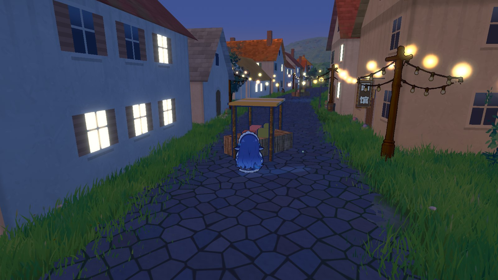

*A walkable hand-painted town in three.js (WebGL2): a 2 km world laid out from two hand-drawn maps, with fishing, farming, weather, a photo camera that renders 4K stills, and lamps, string lights and fireflies at night. Built on the [painted-valley](https://git.patch.gg/blendi/painted-valley) renderer.*

---

## 目录

- [截图](#截图)
- [怎么跑](#怎么跑)
- [操作](#操作)
- [这个世界](#这个世界)
- [能做些什么](#能做些什么)
- [技术说明](#技术说明)
- [素材与授权](#素材与授权)
- [工具](#工具)
- [已知限制](#已知限制)

---

## 截图

| | |
|---|---|
| 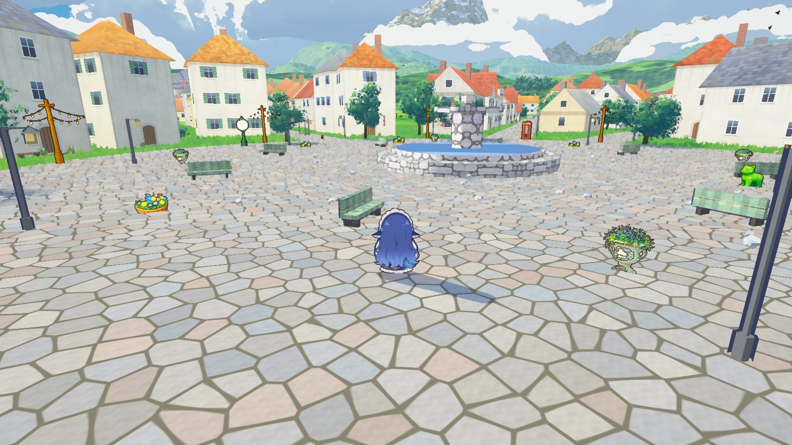 **中央广场**：喷泉、花坛、街钟、电话亭，串灯杆围成一圈 | 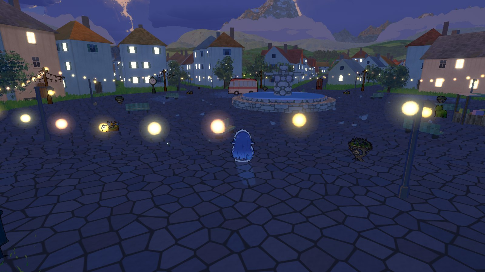 **入夜**：路灯一盏盏亮起来，灯串垂成弧线 |
| 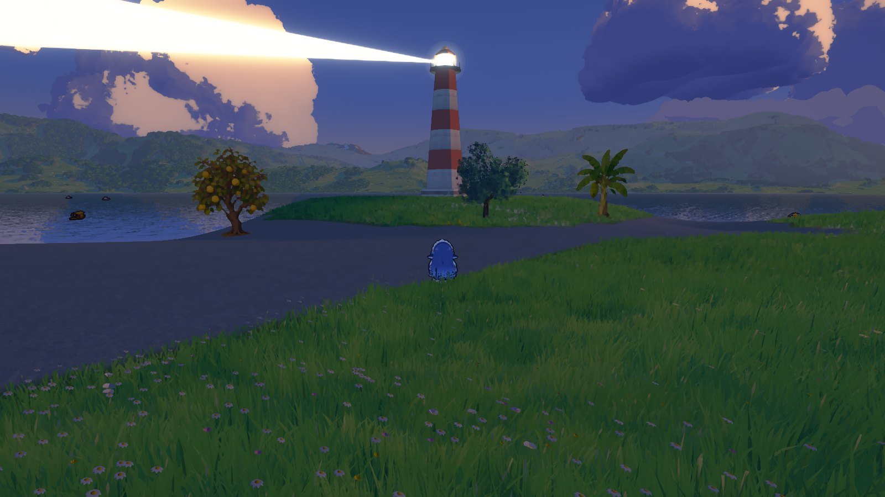 **灯塔**：夜里一道光柱慢慢扫过海面 | 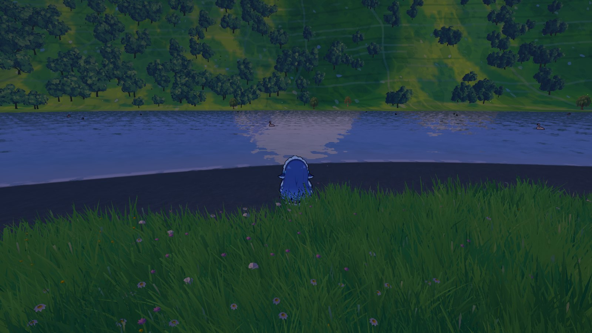 **月亮湖的夜**：湖边、河边、田边的萤火虫一明一灭 |
| 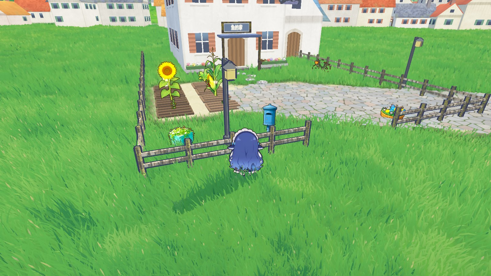 **家门口的菜地**：12 种作物，种下、浇水、看它长 | 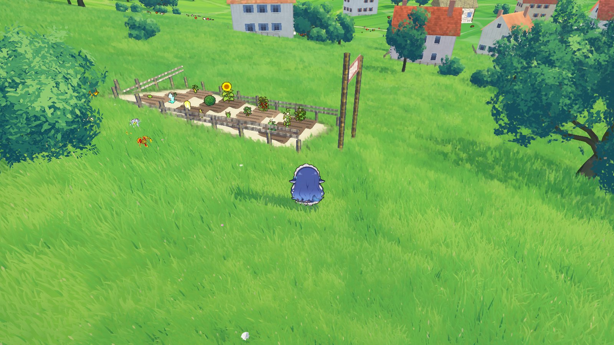 **田园小镇租的菜地**：十二块，围着矮篱笆 |
| 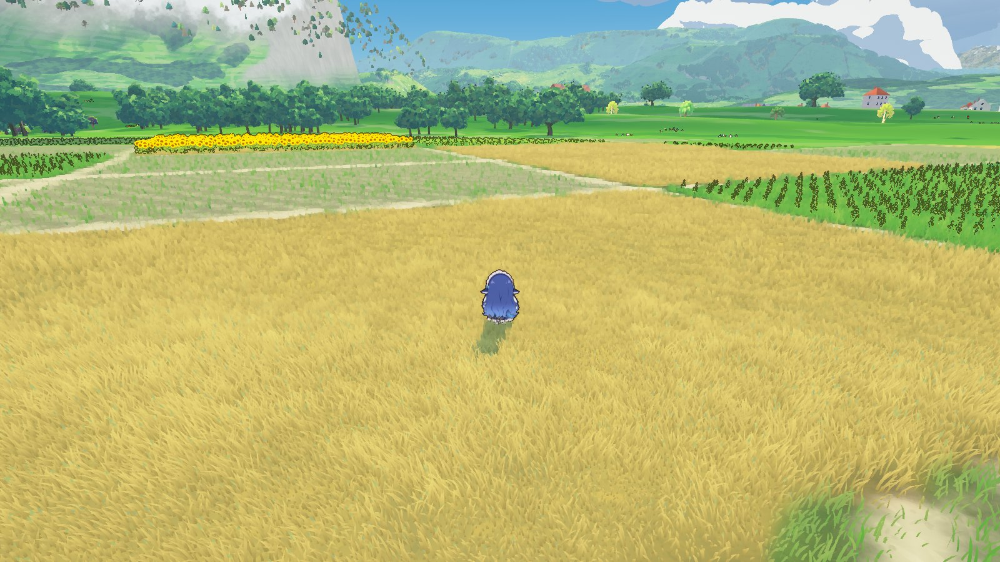 **蔬菜田园**：河西的一块块田，麦子、向日葵、蔬菜 | 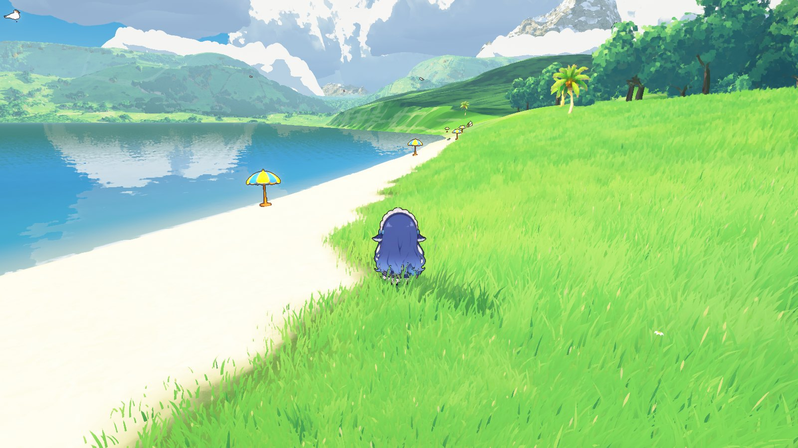 **沙滩**：东北角的海边，一排阳伞 |
| 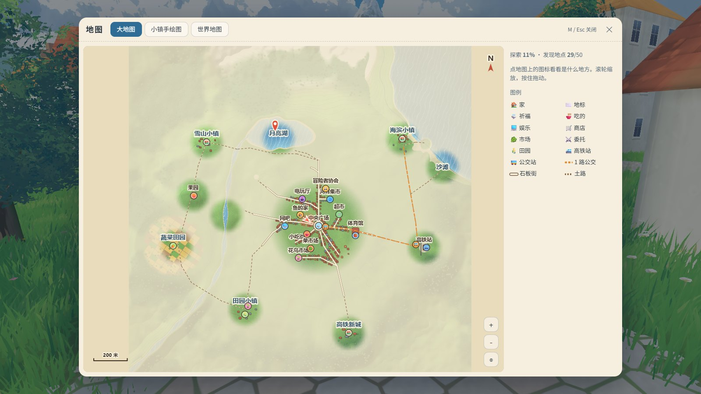 **大地图（M）**：手绘感全图，走过才亮，能设目标、坐车 | 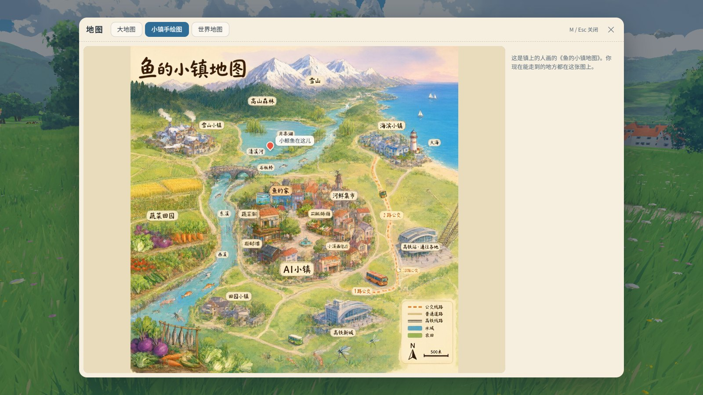 **小镇手绘图**：世界就是照这张图摆的，红点是你 |
| 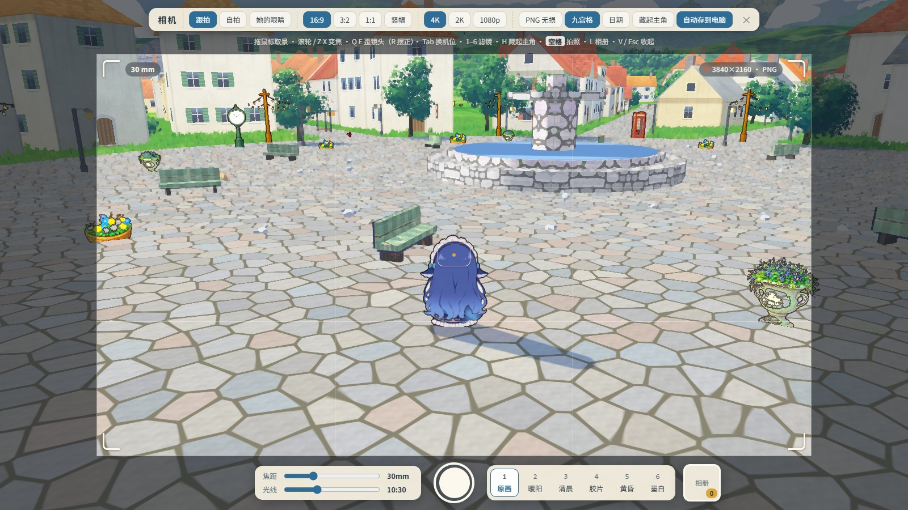 **相机（V）**：取景框、焦距、滤镜，拍下来是 4K 的画 | 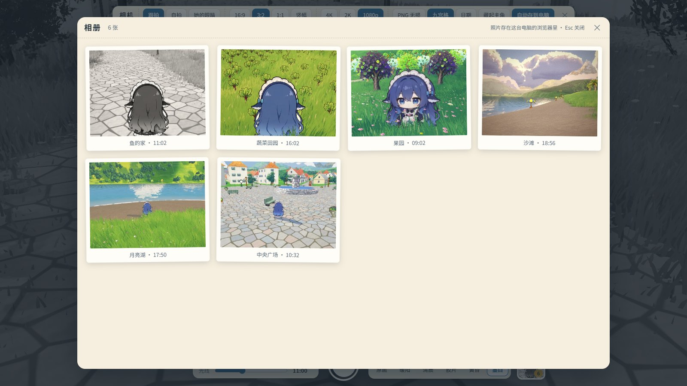 **相册**：照片存在浏览器里，可以存到电脑 |
| 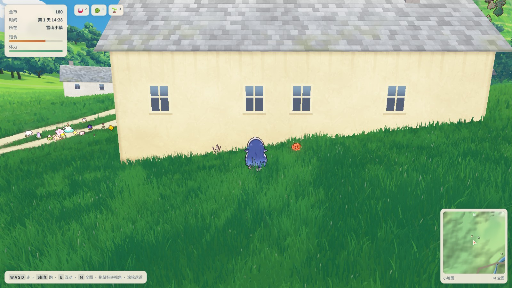 **霜雪天** |  **家里**：四室两厅 |

---

## 怎么跑

需要 **Node.js 20+** 和 **git-lfs**（贴图、图集等图片走 LFS，约 350 MB）。

```bash
git lfs install
git clone https://github.com/shilaoban666/deepseeks-world.git
cd deepseeks-world
npm install          # three + vite + playwright-core
npm run build        # 产出 dist/
npm run serve        # http://127.0.0.1:5383/
```

打开 **http://127.0.0.1:5383/town.html**。（`index.html` 是原来的山谷 demo，说明见 [README-painted-valley.md](README-painted-valley.md)。）

> 必须用服务器打开，不能双击 HTML：页面用 ES module，还要 fetch 贴图。
> 只想看代码、不要大图：`GIT_LFS_SKIP_SMUDGE=1 git clone ...`，之后需要哪批再 `git lfs pull --include "public/**"`（游戏运行只需要 `public/`，`assets/` 是素材库原图）。

### 画质

| 参数 | 作用 |
|---|---|
| `?quality=high` | 默认。MSAA 4×、云图 2048、远山贴条 12288 |
| `?quality=medium` | 核显推荐：MSAA 2×、云图 1024 |
| `?quality=low` 或 `?lite=1` | 最低档：无 MSAA、草更稀、默认开动态分辨率 |
| `?dpr=0.8` | 少画像素再拉伸 |
| `?weather=rain` | 开局的天气（clear / sunny / cloudy / windy / rain / storm / frost） |
| `?paint=0` | 关掉笔触收尾（对比用） |
| `?tex=0` / `?plants=0` | 关掉手绘贴图 / 植物图集，退回纯 shader 画法 |

核显（如 Intel UHD 630）上 **`town.html?lite=1`** 约 20 多帧；独显满帧。

---

## 操作

| 键 | 作用 |
|---|---|
| `W A S D` | 走（方向跟着镜头），`Shift` 跑，`Space` 跳 |
| **`E`** | 互动：屏幕下方会提示能做什么（钓鱼、种菜、浇水、收菜、开门、坐下……） |
| `F` / `C` / `R` / `G` | 爬树 / 潜水 / 躺下晒太阳 / 点火（火会顺着风烧草，下雨能浇灭） |
| `B` / `T` | 背包（里面有鱼类图鉴）/ 天气面板 |
| **`M`** | 大地图：滚轮缩放、拖动、点地点看详情、设目标、坐车；页签能翻到两张手绘纸地图 |
| **`V`** | 相机：空格拍照，滚轮或 `Z X` 变焦，`Q E` 歪镜头，`Tab` 换机位，`1–6` 滤镜，`L` 相册 |
| `P` | 开关笔触收尾 |
| 拖鼠标 / 点画面锁鼠标 | 转视角；滚轮拉近拉远；`Esc` 关面板 |

---

## 这个世界

可走的范围 2 km 见方，照两张手绘地图摆：

- **《鱼的小镇地图》**（`public/maps/town.jpg`）就是可走的这片：图上 1 像素 ≈ 2 米，镇中心在图正中。
- **《幻想世界地图》**（`public/maps/world.jpg`）是更大的世界：玉海城、大学城、港口……可走的只是其中 AI 小镇那一块。

**AI 小镇**：小鲸鱼的家 · 中央广场 · 小吃街 · 菜市场 · 花鸟市场 · 河鲜集市 · 超市 · 网吧 · 电玩厅 · 图书馆 · 学校 · 教堂 · 夫子庙 · 体育馆 · 冒险者协会 · 游乐场 · 三个居民区 · 清镇市城门

**镇外**：月亮湖（北，山脚下）· 清溪河和石板桥、东溪桥 · 雪山小镇（西北）· 高山森林和雪山（北）· 麦田、果园、蔬菜田园（河西）· 田园小镇和租的菜地（西南）· 海滨小镇、灯塔、沙滩（东北海边）· 高铁站（东）· 高铁新城（东南）

**会动的**：天上一群群的燕子麻雀、海上的海鸥、湖里的鸭子鸳鸯天鹅、河滩上的苍鹭白鹭、田里的乌鸦喜鹊；海上漂着渔船帆船；1 路公交在镇子、高铁站和海滨小镇之间来回开。

**家里**：16 × 12 m 的四室两厅，层高 2.9 m，家具按真实尺寸；墙朝镜头的一侧会剖开。

---

## 能做些什么

- **钓鱼**：湖、河、海各有各的鱼（79 种，常见 / 少见 / 稀有 / 传说），越稀有越难拉；钓到的进**鱼类图鉴**。
- **种地**：12 种作物（萝卜、白菜、豌豆、大蒜、土豆、番茄、辣椒、红薯、玉米、花生、向日葵、茶树），6 到 36 个游戏小时成熟。浇过水长得快，下雨天自己就湿了；熟了地里会亮。种子铺买种子，菜市场收菜；自己种的菜能下锅。
- **果园和菜地**：每天能摘一次果子和青菜。
- **做饭、吃饭、睡觉、洗澡、看电视、看书**，沙发和床能坐能躺。
- **买东西、上网、打电玩、接委托、许愿、祈祷、采花、翻信箱、荡秋千**。
- **动作**：跑、跳、爬树、游泳、潜水（有氧气条）、躺着晒太阳、点火。
- **天气**：晴、大太阳、多云、大风、雨、雷雨（闪电会劈草地）、霜雪，会自己慢慢变，也能在天气面板里手动换。
- **大地图**：没去过的地方蒙着纸，走过才亮；设个目标，小地图上有方向和距离；家、公交站、高铁站能坐车过去。
- **相机**：取景框和成片一致；三种机位（跟拍、自拍、她的眼睛）；14–200 mm 焦距；4 种画幅、3 档清晰度；6 种滤镜和日期水印；取景时可以把天光拨到任意时刻。照片不是放大截图，而是用同一套光和笔触在 3840×2160 的画布上重画一遍。
- **一天 12 分钟**：天光从早到晚变，夜里灯亮、萤火虫出来。

---

## 技术说明

### 沿用的（来自 painted-valley）

- **`src/lib/frame.js` 的收尾**：HDR → 火 → 合成 → bloom → **Kuwahara 笔触 + alpha 墨线** → 画家曲线。画面的手绘感主要来自这一步。这一版给它加了可选的渲染目标，相机拍照就是把整条管线在 4K 画布上再跑一遍。
- **`src/lib/` 的草地**：instanced 草叶、踩踏记忆、野花、割草、火焰。
- **`src/valley/` 的天空**：云一次烘进 cubemap，远山烘成贴条。

### 新写的（`src/town/`）

| 文件 | 职责 |
|---|---|
| `plan.js` | 地形纯函数 `heightAt(x, z)`、街区表、路网、湖、河、海岸线、菜地；照小镇手绘图摆 |
| `city.js` | 把街区摆好：建筑、树、作物、街景立牌，产出场景 + 碰撞盒 + 互动点 + 会亮的点 |
| `buildings.js` / `paint.js` | 建筑生成器；cel 材质（两阶色 + 墨线壳 + shader 里长的瓦、墙渍、木纹），手绘贴图只借笔触不借光 |
| `player.js` / `actions.js` | 鲸鱼娘立牌、第三人称相机、走路碰撞；跑跳爬树游泳潜水的状态机 |
| `interactions.js` / `panels.js` / `ui.js` | 互动、面板、HUD、小地图 |
| `bigmap.js` | 大地图：烘一张手绘感底图，路和房子实时画；探索、目标、坐车、纸地图上的定位 |
| `weather.js` / `particles.js` | 天气（风、雨、雷、霜、大太阳）和粒子 |
| `fishdex.js` | 79 种鱼、三片水、稀有度 |
| `farming.js` | 12 种作物、菜地、生长、浇水、收获 |
| `life.js` | 鸟、鸭子、船：手绘精灵，按方向翻面，飞的上下压一压当扇翅膀 |
| `glow.js` | 夜里的光：光晕、地上的光斑、灯串、灯塔光柱、萤火虫、熟菜的小星 |
| `photo.js` | 相机和相册：4K 离屏渲染、滤镜冲洗、后台线程压 PNG、IndexedDB 存相册 |
| `interior.js` | 四室两厅 |

### 几个做法

1. **立牌的 alpha 技巧**：主角、植物、鸟、街景都是不透明立牌，片元里写一个很小的 alpha。收尾的笔触看到它就跳过（手绘线条保住），墨线检测看到它和背景的 alpha 差，就自动描一圈墨线。
2. **夜里的光不被压蓝**：夜景是整幅画压暗压蓝（像电影的日拍夜）。光晕叠加之前先除以这层颜色，压完还是暖黄；叠加混合只加颜色、不动 alpha，所以笔触和墨线照常。
3. **照片和取景框对得上**：取景框的长宽比就是照片的长宽比，屏幕视角按框的大小反算；拍照时笔触的取样间隔随画布放大，4K 照片读起来还是同一幅画。PNG 交给 Worker 里的 OffscreenCanvas 压，游戏只停顿渲染那一下。
4. **图集**：植物、鱼、作物、鸟和街景一共打成 7 张图集，几千个立牌只花十几个 draw call。

---

## 素材与授权

全部贴图和精灵的清单、路径和逐项介绍见 **[docs/贴图说明.md](docs/贴图说明.md)**（约 1800 个资产）。游戏里实际用到的：43 张建筑材质、3 张室内墙纸地砖、139 种花、110 种树、120 种鱼、30 种作物和 50 种果树、19 种鸟、32 件街景、15 种车船。

- **代码**：MIT（沿用 painted-valley，见 [LICENSE](LICENSE)）。
- **山谷原作的画**：CC0，作者 Patch，见 [LICENCE-NOTES.md](LICENCE-NOTES.md)。
- **鲸鱼娘形象**：来自 DSH 桌面宠物插件 `dsh-pet` 的立绘（社区二创形象，原型为 B 站 UP 主「上善无形」的原创角色「溟月」）。立绘允许开源使用、**禁止商用**；这里仅作学习和个人使用。
- **新增的手绘贴图和精灵、两张手绘地图**：AI 生成（dashscope qwen-image），经本地脚本切分、打成图集。
- 第三方库：three.js（MIT）、Rapier（Apache-2.0）、vite（MIT）。
- 五段环境音来自 Sonniss GDC 素材包，授权只允许用在游戏里、不允许当文件分发，所以**不在仓库里**（见 [MISSING_ASSETS.md](MISSING_ASSETS.md)）。

> 地形、建筑形体、天空、草地、水面都在 shader 里算；贴图只借笔触和花纹，颜色还是调色板的。

---

## 工具

| 命令 | 作用 |
|---|---|
| `node tools/town-shots.mjs [机位...] --out shots/x [--photo 4K] [--nohud 1]` | 截图（机位表在文件开头）；`--photo 4K` 每个机位再用游戏里的相机拍一张原尺寸照片 |
| `node tools/town-check.mjs` | 自检：动作、天气、钓鱼、大地图、种地、相机，全跑一遍 |
| `node tools/town-perf.mjs "lite=1&dyn=0"` | 帧时间，分别关掉树、城市、草地、笔触各量一次 |
| `node tools/town-layout.mjs` | 布局自检：路有没有不经过桥下水、桥在不在河上 |
| `py -3.11 tools/pack-extra.py` | 把素材库里用到的鱼、作物、果树、鸟、街景、车船打成图集 |

工具用本机的 Chrome（`CHROME` 环境变量可以改路径）。

---

## 已知限制

- **只有自己家能进**，其他建筑是门面 + 交互。
- **没有存档**，刷新回到第一天早上（相册除外，照片存在浏览器里）。
- 世界图上的玉海城、大学城、港口还没做，高铁暂时只是个站。
- 主角立绘 512×768，4K 自拍特写会比周围略软。
- 立牌（鸟、车、街景）永远面朝镜头，从侧面看不出厚度。
- 性能：UHD 630 核显低配档在广场一帧约 44 毫秒。

更细的开发记录（每一版做了什么、为什么、怎么验证）在 **[小鲸鱼的世界.md](小鲸鱼的世界.md)**。
